# Bedienung

Diese Anleitung richtet sich an alle, die `thermoctl` benutzen — nicht betreiben. Wer
die Anlage einrichtet, eine eigene Instanz aufsetzt oder scharf schaltet, findet das in
[self-hosting.md](self-hosting.md), [inbetriebnahme-schattenbetrieb.md](inbetriebnahme-schattenbetrieb.md)
und [scharfschalten.md](scharfschalten.md). Hier geht es um die Weboberfläche selbst.
Für Bewohner ohne Technikbezug gibt es zusätzlich die [Wohnungs-Anleitung](wohnung.md).

**Ein Fachbegriff, den die Oberfläche nicht erklärt?** Das [Glossar](glossar.md) erklärt
sie in einfachen Worten — dieselben Texte stehen in der Oberfläche unter **Glossar & Hilfe**
(Seitenleiste unten). Neben schwierigen Einstellungen führt ein kleines Fragezeichen direkt
zum passenden Eintrag.

## Eine Oberfläche, Rechte entscheiden

Es gibt **eine** Weboberfläche für alle: Bewohner und Verwaltung sehen dieselbe Anwendung,
die Seitenleiste zeigt nur, was für das eigene Konto erreichbar ist. Das entscheiden die
**Rechte der Gruppe** — eine Person darf alles, was mindestens eine ihrer Gruppen erlaubt,
und Rechte für Räume lassen sich auf einzelne Räume beschränken. Daneben trägt jede Gruppe
ein **Oberflächen-Profil** (Anlage oder Wohnung). Es ist keine Berechtigung, sondern trennt
nur einzelne Bereiche voneinander: Die Seitenleiste eines Wohnungsprofils führt nur
Übersicht, Wochenpläne, Temperatur & Heizzeit und das Konto; Urlaub für die ganze Anlage, Geräte,
Betrieb, Einstellungen, Benutzer- und Gruppenverwaltung, die Betriebsart und die Temperaturen
je Modus eines Raums gehören zum Anlagenprofil, die persönliche Abwesenheit zum
Wohnungsprofil (nur dieses sieht sie auf der Seite Wochenpläne). Alles Übrige — etwa das Bearbeiten von Wochenplan-Zeiten eines Raums —
entscheidet allein das Recht für diesen Raum.

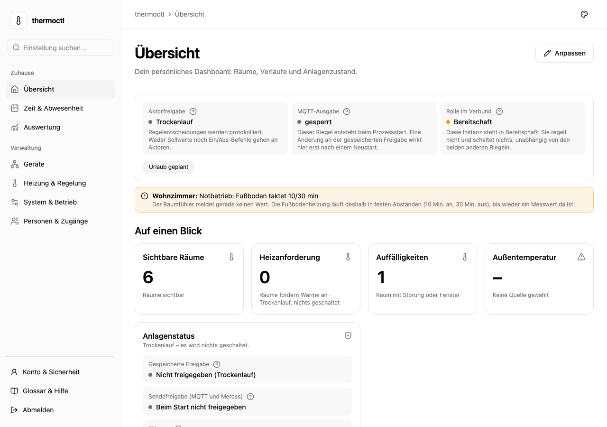

## Anmelden und Aufbau

Die Anmeldeseite fragt nach Benutzername und Passwort; ist für die Anlage eine
Passkey-Anmeldung eingerichtet, gibt es sie dort zusätzlich. Läuft die Sitzung ab, führt die
Oberfläche zurück zur Anmeldung. Wie man ein Konto bekommt und was es darf, entscheidet
die Verwaltung unter **Personen & Zugänge**.

Links steht die Seitenleiste mit einer **Einstellungssuche** (sie sucht in den sichtbaren
Bereichen und ihren Stichwörtern) und bis zu sieben Bereichen. Unter „Zuhause“ stehen
**Übersicht**, **Zeit & Abwesenheit** und **Auswertung**, unter „Verwaltung“ **Geräte**,
**Heizung & Regelung**, **System & Betrieb** und **Personen & Zugänge**. Ein Bereich
erscheint nur, wenn das Konto mindestens eine seiner Seiten sehen darf. Ganz unten stehen
**Konto & Sicherheit**, **Glossar & Hilfe** und **Abmelden**. Am Telefon wird die Seitenleiste
über die Schaltfläche oben links eingeblendet. Das Farbsymbol oben rechts wechselt
Darstellung (Hell, Dunkel, System) und Akzentfarbe.

## Übersicht und eigenes Dashboard

Die Übersicht ist ein **persönliches Dashboard** aus Kacheln. Das Layout wird je Benutzer
gespeichert. **Anpassen** öffnet den Bearbeitungsmodus: Kacheln aus der Galerie hinzufügen,
je Kachel Einstellungen öffnen, entfernen und umsortieren (ziehen oder, am Griff, mit den
Pfeiltasten), dann **Speichern**. Hat jemand das Layout zwischenzeitlich anderswo
gespeichert, weist die Oberfläche darauf hin und behält den eigenen Entwurf. Welche
Kachelarten und -ziele zur Wahl stehen, hängt von Rechten und Profil ab.

Die Standard-Übersicht der Verwaltung zeigt oben drei Zustandsanzeigen: ob die Regelung im
Trockenlauf oder scharf ist (**Aktorfreigabe**), ob die **MQTT-Ausgabe** (der beim
Prozessstart gebaute zweite Riegel) noch gesperrt ist, und — falls mehrere Instanzen
denselben Bestand teilen — welche **Rolle im Verbund** diese Instanz hat. Dazu kommen der
Chip „Urlaub geplant“ bzw. „Urlaub läuft“, ein Hinweis, wenn ein Raum im Notbetrieb ist,
die Kennzahlen „Auf einen Blick“ (sichtbare Räume, Heizanforderung, Auffälligkeiten,
Außentemperatur) und der Anlagenstatus. Darunter stehen die Raumkarten mit Ist-Temperatur
und Sollwert samt Begründung und einem Farbband mit dem Tagesverlauf.

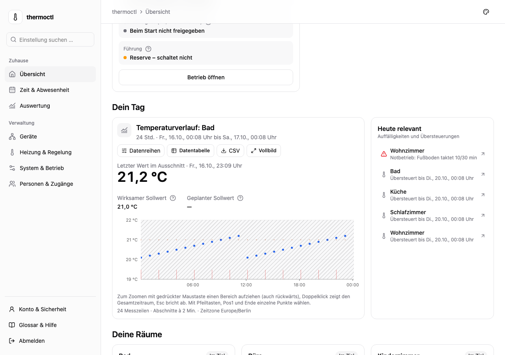

Auf dem Telefon sieht ein Wohnungskonto dieselbe Übersicht ohne Anlagentechnik:

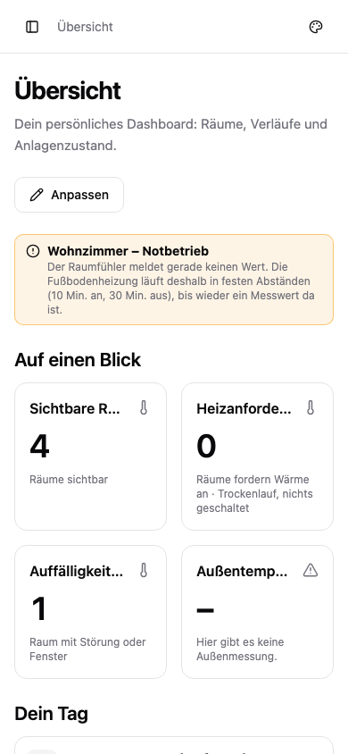

## Raum

Ein Klick auf eine Raumkarte öffnet den **Raum**. Er zeigt Ist-Temperatur, den wirksamen
Sollwert samt Begründung und den Tagesverlauf als Farbband, außerdem Sensorstatus
(Messwert, Fenster, „Messwert hängt“) und die letzte **Regelentscheidung** mit Ergebnis,
Begründung und Zeitpunkt. Über dem Raum führen Knöpfe zu Zeitplan, Geräten, Datenfluss und
Verlauf. Je nach Recht gibt es darin:

- **Sollwert anpassen** (− / +): ändert die normale Temperatur des gerade laufenden
  Zeitplan-Abschnitts **dauerhaft**, nicht nur für heute. Solange eine Übersteuerung läuft,
  ist der Knopf gesperrt („erst beenden, dann den Sollwert ändern“).
- **Befristete Übersteuerung:** eine feste Temperatur bis zu einem gewählten Zeitpunkt oder
  unbefristet; danach gilt wieder der Wochenplan. Sie lässt sich vorzeitig beenden.
- **Nächste Phase:** zeigt, was der Zeitplan als Nächstes vorsieht; **Jetzt vorziehen**
  nimmt es vorweg. Läuft schon eine Übersteuerung, steht dort **Übersteuerung ersetzen**.
- **Betriebsart** (Anlagenprofil, `zone.manage`): z. B. den Raum ausschalten — er hält dann
  nur noch den Frostschutz.
- **Temperaturen je Modus** (Anlagenprofil, `setpoint.write`): Komfort, Tag, Nacht,
  Frostschutz. **Entfernen** löscht den Wert; der Raum erbt dann den anlagenweiten Vorgabewert.
- **Raumtechnik** (Regelparameter dieses Raums, auch der Notbetrieb, siehe unten) und
  **Problem melden** an die Verwaltung, wenn das Recht dafür da ist.

Räume anlegen, bearbeiten und löschen geht auf der Seite **Übersicht → Räume**; ein Raum
braucht nur einen Namen, Geräte und Zeitplan kommen danach dazu. Löschen lässt sich mit
„Rückgängig“ zurücknehmen.

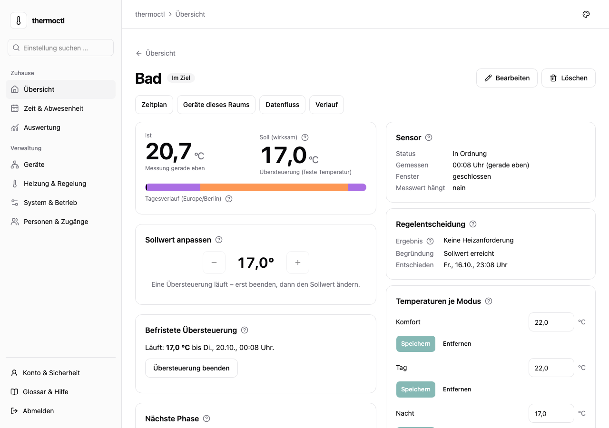

## Zeit & Abwesenheit

### Wochenpläne

Unter **Wochenpläne** wählt man oben einen Raum. Der **Wochenplan** zeigt sieben Tage als
Farbbalken, je Modus eine Farbe (mit Temperatur); der Plan ist ein Ring: Jeder Zeitbereich
gilt bis zum nächsten Schaltpunkt. Darüber steht eine Vorschau der nächsten 24 Stunden. Wer
`schedule.manage` für den Raum hat, kann bearbeiten:

- **Neue Zeit:** Modus oben wählen und auf dem Plan ziehen. Ziehen auf einem langen
  Zeitbereich oder leerem Plan legt eine neue Zeit an und teilt den Bereich; Umschalt
  + Ziehen übermalt auch fremde Schaltpunkte.
- **Verschieben und Kopieren:** einen kurzen Zeitbereich ziehen verschiebt ihn, mit Alt
  (Option) wird er dupliziert. Esc bricht die Geste ab. Die Ränder lassen sich ziehen, um
  Beginn oder Ende zu ändern.
- **Tastatur:** Pfeiltasten am markierten Block verschieben ihn (links/rechts um 15
  Minuten, mit Umschalt 5; hoch/runter auf den Vor- bzw. Folgetag), Alt + Pfeile ändern Ende
  bzw. Beginn, Enter oder Leertaste öffnen den Inspektor, Rücktaste oder Entf löschen den
  Block, Strg/Cmd + Z nimmt zurück, mit Umschalt wird wiederholt.
- **Ohne Zeiger oder Touch:** das Formular „Neue Zeit anlegen“ unter der Vorschau legt einen
  Schaltpunkt (Tag, Uhrzeit, Modus) oder einen Zeitraum innerhalb eines Tages an. Per
  Tastatur lassen sich Blöcke verschieben und kürzen; eine neue Zeit entsteht dort über
  dieses Formular.
- **Inspektor** für Temperatur und genaue Zeiten, ein Feld „<Tag>: zwei Zeiten“ („Tag ab“
  und „Nacht ab“) für einen einfachen Tag, und ein Bereich zum **Kopieren** eines ganzen
  Plans auf einen anderen Raum.
- **Vorschau** der nächsten 24 Stunden: was die Regelung tatsächlich vorsieht — Plan, Urlaub
  und Übersteuerungen in ihrer Rangfolge.

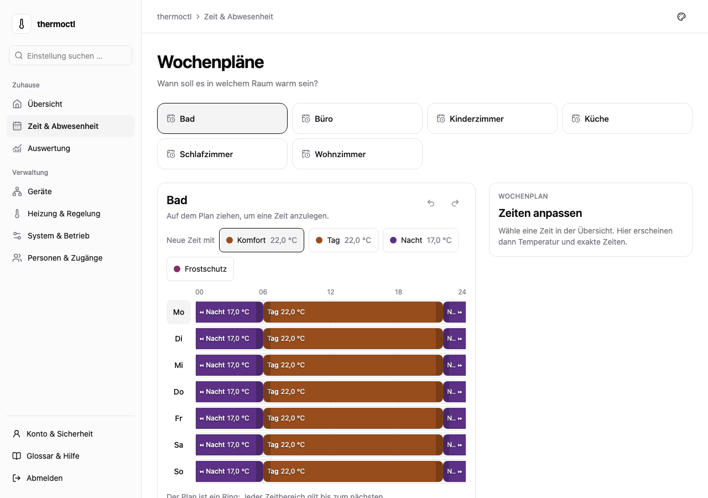

Dasselbe sieht ein Konto im Wohnungsprofil für die eigenen Räume, soweit es dort
`schedule.manage` hat:

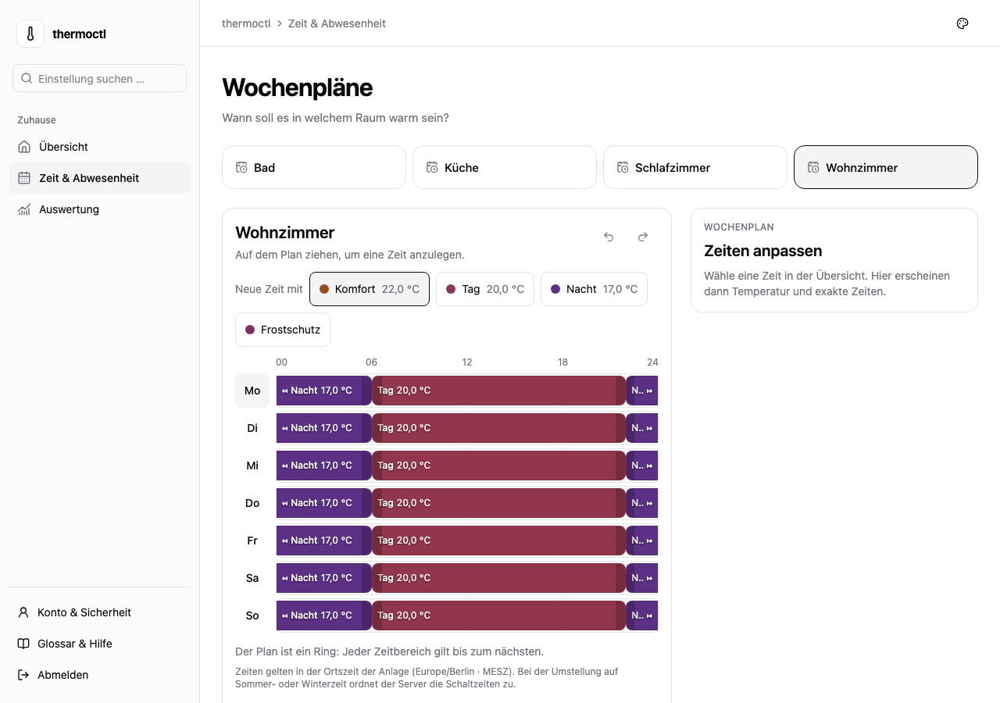

Weiter unten stehen Vorschau und das Formular „Neue Zeit anlegen“:

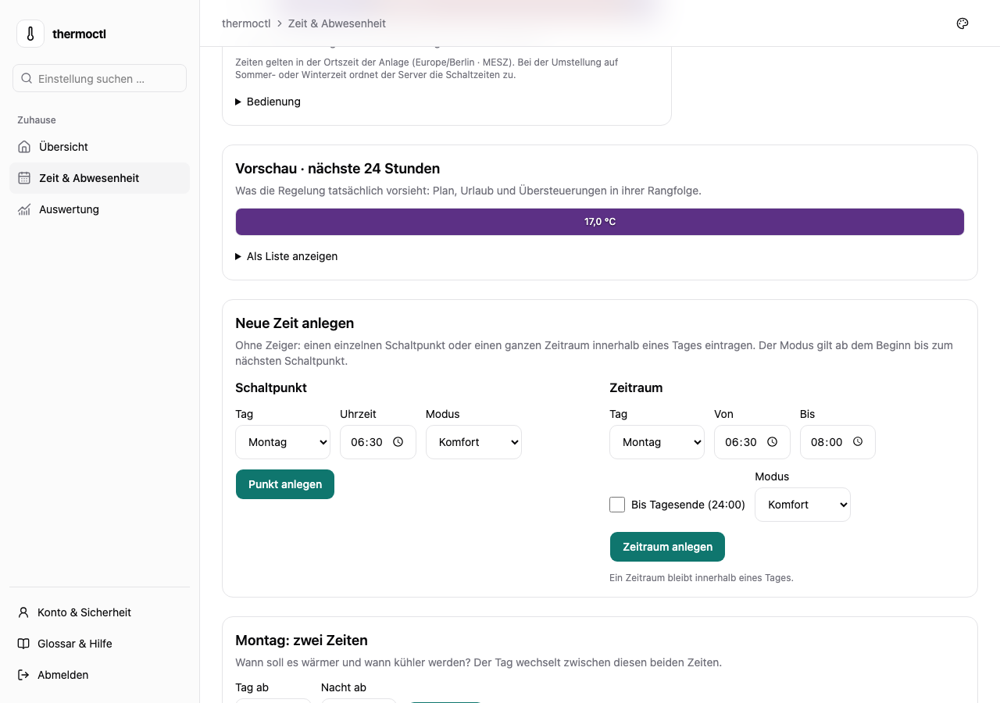

### Urlaub und Abwesenheit

Die **Verwaltung** (Anlagenprofil, Recht `vacation.manage`) setzt unter
**Urlaub & Abwesenheit** einen einzigen Absenkwert für **die ganze
Anlage** über einen zusammenhängenden Zeitraum an — erster und letzter Tag, dazu die
Temperatur, auf die jede Zone währenddessen abgesenkt wird. Fenster, Sensorausfall,
Mindestschaltdauern und Ventilschutz gelten dabei unverändert weiter, und eine Zone in
Betriebsart „Aus“ bleibt aus. Ein geplanter oder laufender Urlaub zeigt seinen Zustand
(„Geplant“ oder „Läuft“) und lässt sich vorzeitig beenden; ein zweiter Urlaub muss den
bestehenden erst beenden. Eine von Hand gesetzte Übersteuerung einer Zone gilt weiter, bis
sie selbst endet.

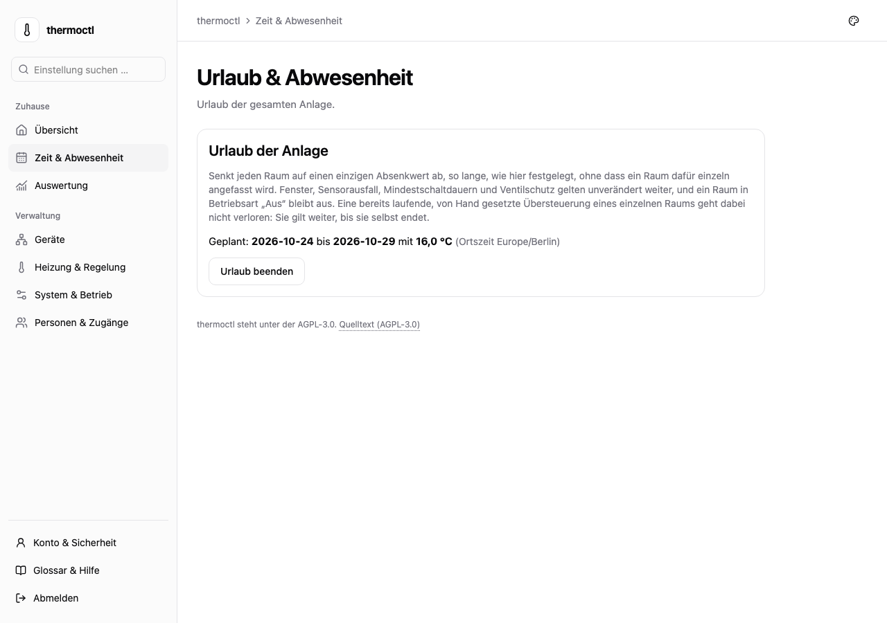

Bewohner (Wohnungsprofil) planen stattdessen auf der Seite **Wochenpläne** ihre
**Abwesenheit**: „Zurück am“ und
eine Temperatur, auf der **alle eigenen Räume** währenddessen gehalten werden; der
Wochenplan bleibt unverändert und gilt danach wieder. Eine laufende Abwesenheit steht mit
Enddatum und „Abwesenheit beenden“ da. Beide Funktionen sind getrennt und lösen oder
beenden einander nicht.

## Auswertung

### Temperatur & Heizzeit

**Temperatur & Heizzeit** zeigt je Raum ein Diagramm (Raum oder „Alle Räume“, Zeitraum
24 Std., 7 oder 30 Tage). Es zeichnet nur, was protokollierte Zeilen belegen: gemessene
Temperatur (bei langen Zeiträumen verdichtet mit Min./Max.), geplanten und wirksamen
Sollwert, die **Heizanforderung** und die **Sonnenabsenkung**; Zeiten ohne Daten stehen
schraffiert als **Messlücke**, nicht als Schätzwert. Mit Maus oder Tastatur (Pfeiltasten,
Pos1, Ende) liest man Werte an einer Stelle ab. Mit der Maus lässt sich durch Ziehen
zoomen; Touch zoomt nicht, damit Wischen die Seite scrollt. Die **Datenreihen** lassen sich
ein- und ausblenden, die **Datentabelle** ist die Textfassung, **CSV** lädt die Zahlen
herunter, **Vollbild** vergrößert die Kachel. Läuft die Anlage im Trockenlauf, steht
darüber ein Hinweis, dass Sollwert und Heizanforderung Entscheidungen der Regelung sind,
keine Aufzeichnung dessen, was in den Räumen geschah.

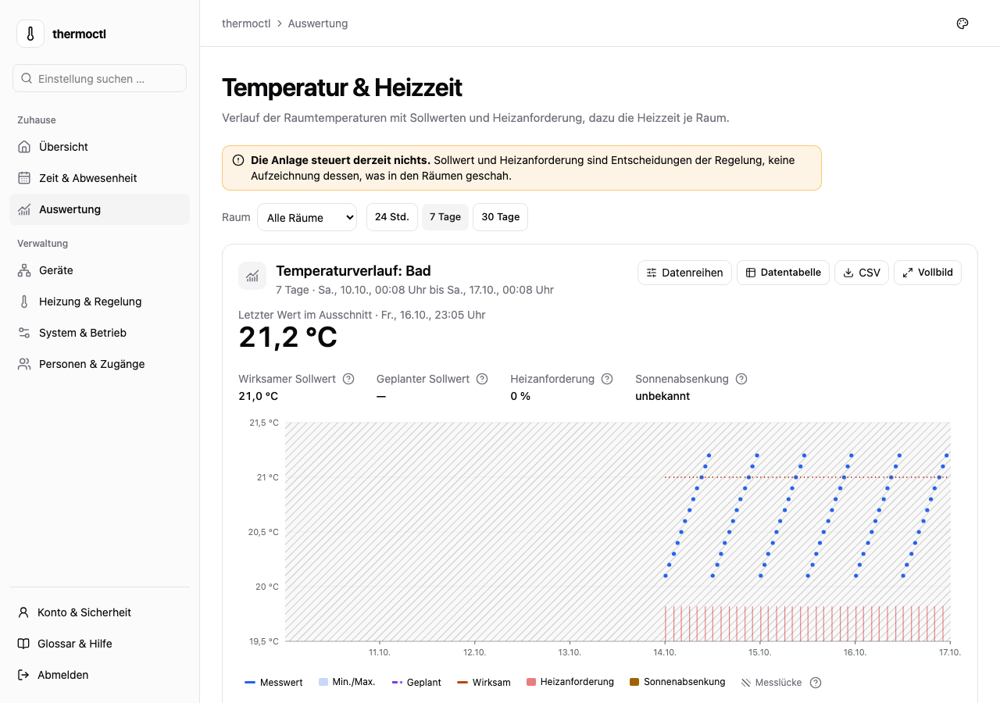

Im Wohnungsprofil trägt dieselbe Seite eine Erklärung zu Linie, Zielwerten und Heizanforderung
(„Zielwert ohne Sonnenabsenkung“, „Tatsächlicher Zielwert“):

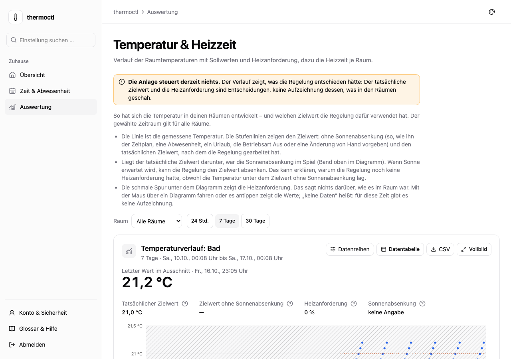

### Heizzeit

Darunter zeigt **Heizzeit** je Raum, wie viele Stunden in einem wählbaren Zeitraum eine
Heizanforderung bestand — als einfache Orientierung, ausdrücklich **kein** Energie- oder
Kostenmesser und keine Bestätigung einer körperlichen Heizwirkung: Wie warm ein Raum
tatsächlich wurde, hängt zusätzlich von Außentemperatur, Gebäudezustand und Lüften ab. Im
Trockenlauf zeigen die Balken, wann *geheizt worden wäre*, nicht was wirklich geschah.

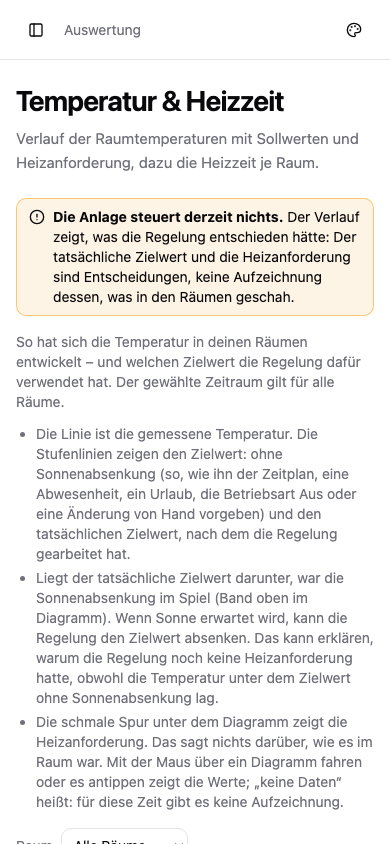

### Ereignisse

**Ereignisse** führt drei Protokolle zusammen: das **Schaltprotokoll** (jeder Befehl, der an
ein Gerät hinausging oder im Trockenlauf unterdrückt bzw. verworfen wurde, mit Zeitpunkt,
Raum, Gerät, Befehl, Ergebnis und aufklappbarer Begründung), das **Audit** und das
**Änderungsprotokoll**. Filter grenzen lange Listen ein, die Audit-Liste gibt es als CSV.
Eine protokollierte Änderung lässt sich **zurücknehmen**; wurde seitdem etwas anderes
geändert, weist die Oberfläche darauf hin, dass das neuere Werte überschreiben würde. Wie
man ein unauffälliges Schaltprotokoll von einem mit echtem Problem unterscheidet, erklärt
[scharfschalten.md](scharfschalten.md#4-wie-man-das-schaltprotokoll-liest).

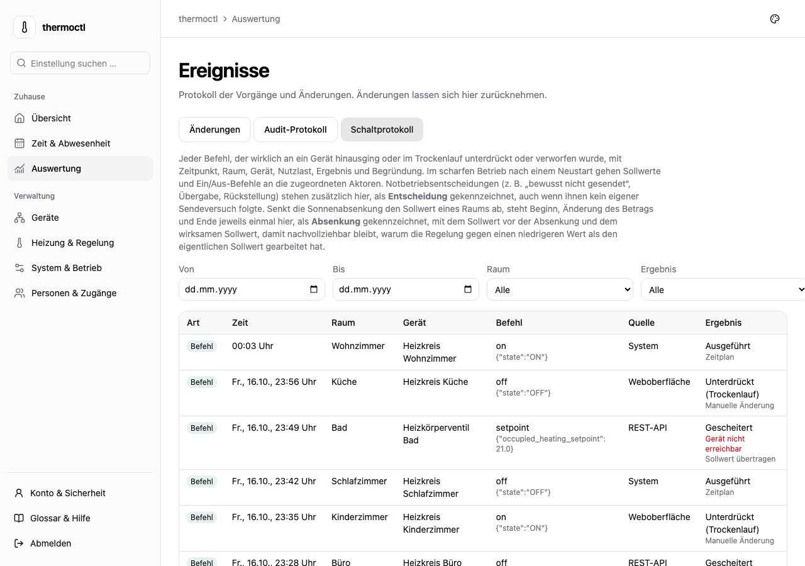

### Relaisverschleiß

**Relaisverschleiß** zählt Schaltspiele je Gerät und Tag und rechnet sie auf ein Jahr hoch,
verglichen mit einer angenommenen Relais-Lebensdauer (Vorgabe 500.000 Schaltspiele — eine
Annahme, keine Herstellerangabe, einstellbar unter Regelvorgaben). Auch die gewöhnliche
Hysterese verschleißt ein Relais, nur langsamer. Die Heizstatistik selbst zeigt
Regelentscheidungen, keine bestätigte körperliche Heizwirkung.

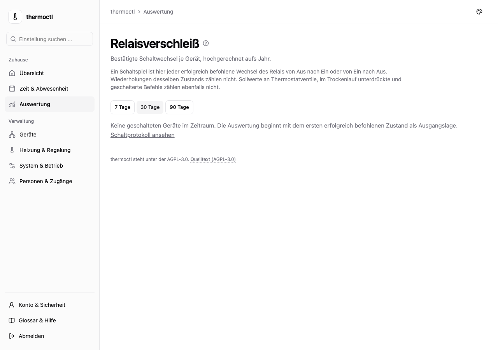

## Geräte

### Geräte und Zuordnung

**Geräte & Zuordnung** hat zwei Reiter. **Geräte** listet alle bekannten Geräte mit Raum,
Verbindungsstatus (Zigbee2MQTT-Signalstärke und Batterie, oder „hat sich noch nie
gemeldet“, solange keine MQTT-Nachricht einging; bei Meross-Geräten, die sich nie über MQTT
melden, sondern nur stündlich beim Geräteabgleich mit der Cloud: „wurde noch nie als online
abgeglichen“) und Fähigkeiten — Temperaturmessung, Schaltausgang oder Thermostatventil.
Auffälliges steht zuerst, ein Suchfeld und „nur Auffälliges“ grenzen ein. **Zuordnung je
Raum** legt pro Raum die Temperaturquelle fest, ordnet Geräte zu (per Auswahlfeld) und
tauscht ein Gerät aus; dort steht auch die Tastenzuordnung.

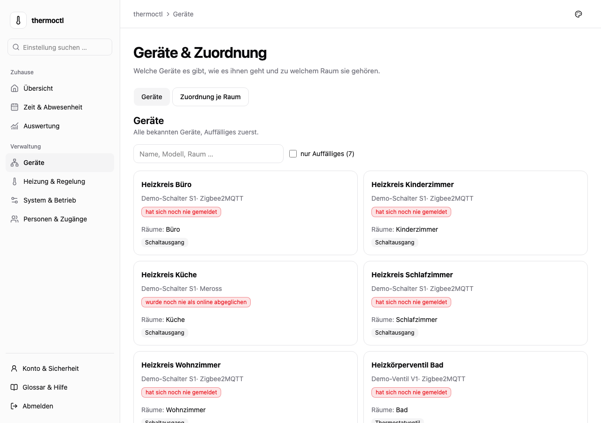

### Gerätekarte, Datenfluss und Anlagenbild

Die **Gerätekarte** stellt Raumfühler links, Räume in der Mitte und Heizkreise rechts dar,
verbunden durch Linien (Ausgang rechts, Eingang links, Farbe nach Art des Wertes). Es lässt
sich zoomen, einpassen, automatisch anordnen, suchen und per **Liste** statt Karte ansehen;
Verbindungen werden dort verbunden und getrennt. **Datenfluss** zeigt je Raum, welcher Wert
von welchem Gerät kommt und was `thermoctl` an welchen Aktor schreiben würde, je nach
Betriebsart des Ventils: Schaltbefehle bei einem Schaltaktor, Sollwert und Istwert bei einem
Ventil, das selbst regelt, nur die Raumtemperatur bei „Nur Raumtemperatur melden“.
Gestrichelt ist, was fehlt. Ob gerade wirklich geschrieben wird oder nur im Trockenlauf
entschieden, zeigt die Seite nicht. Das **Anlagenbild** gruppiert die Geräte je Raum und
nennt Geräte ohne Raum.

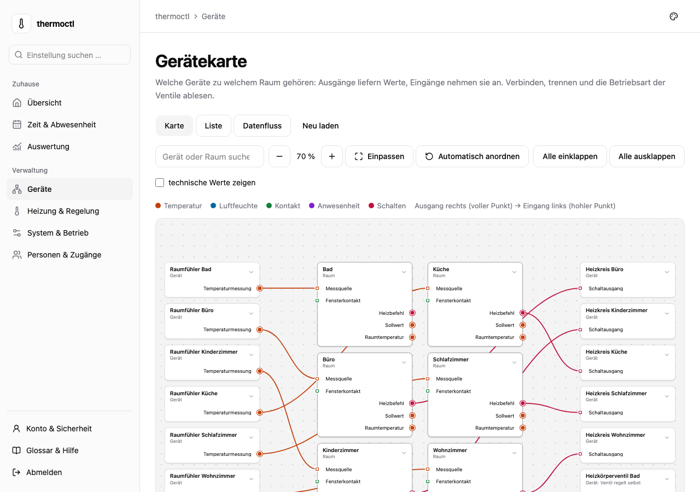

**Bediengeräte** zeigt für Fernbedienungen und Taster, was ankommt und was hingeschickt
wird, und die Tastenbelegung.

## Heizung & Regelung

**Regelvorgaben** fasst die anlagenweiten Werte zusammen, die ein Raum erbt, solange er
nichts Eigenes einträgt: Regelzyklus, Hysterese, Mindest-Schaltdauern, Sensor-Timeouts und
die PI-Regelung. Eigene Seiten gibt es für **Temperaturmodi**, **Fenster & Alarm**
(Fenster-Erkennung per Temperatursturz, Alarm bei vergessen offenem Fenster),
**Notbetrieb & Sensorfehler** (siehe unten), **Sonnenabsenkung** (Standort und Vorausschau;
die Absenkung bleibt nie unter dem Frostschutz des Raums) und **Außenfühler** (Quelle der
Außentemperatur). Ein leeres Feld in einem Raum bedeutet überall: Wert erben.

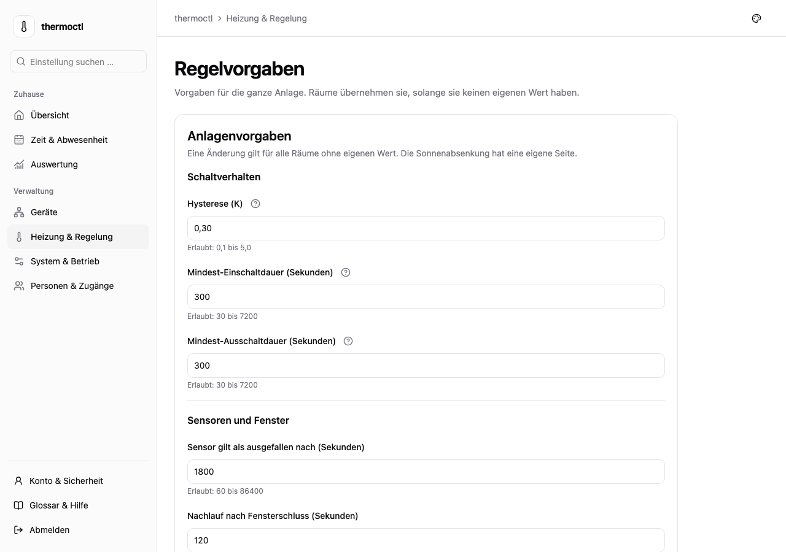

## System & Betrieb

### Betrieb und Freigaben

**Betrieb & Freigaben** ist der Ort, an dem entschieden wird, ob die Anlage wirklich
schaltet. Das hängt von **drei getrennten Riegeln** ab, die nebeneinander stehen und nicht
zusammengefasst werden:

1. **Gespeicherte Freigabe** — ob eine Freigabe erteilt wurde. Sie ändern nur Personen mit
   dem Recht „Freigabe“ (`control.arm`), über **Freigabe erteilen …** mit Begründung.
2. **Sendefreigabe (MQTT und Meross)** — wird beim Start des Dienstes gebildet und gilt für
   alle Wege, auf denen Befehle hinausgehen. Eine Änderung der gespeicherten Freigabe
   wirkt hier erst nach einem Neustart.
3. **Führungsrolle im Verbund** — teilen mehrere Instanzen einen Bestand, schaltet nur die
   führende; eine Reserve regelt nicht und schaltet nichts.

Dazu zeigt die Seite **Trockenlauf**: Im Trockenlauf — der Vorgabe nach jeder
Einrichtung — protokolliert die Regelung nur, was sie täte; es geht nichts an ein Gerät
hinaus. Darunter steht je Raum Ist-Wert, Sollwert und die aktuelle Entscheidung mit
Begründung. Die genaue Reihenfolge des Scharfschaltens steht in
[scharfschalten.md](scharfschalten.md).

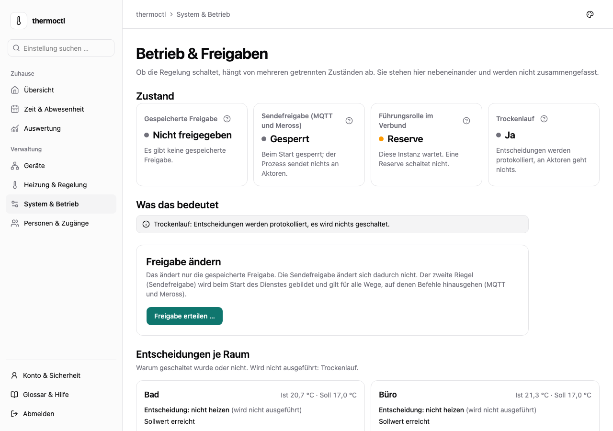

Weiter unten:

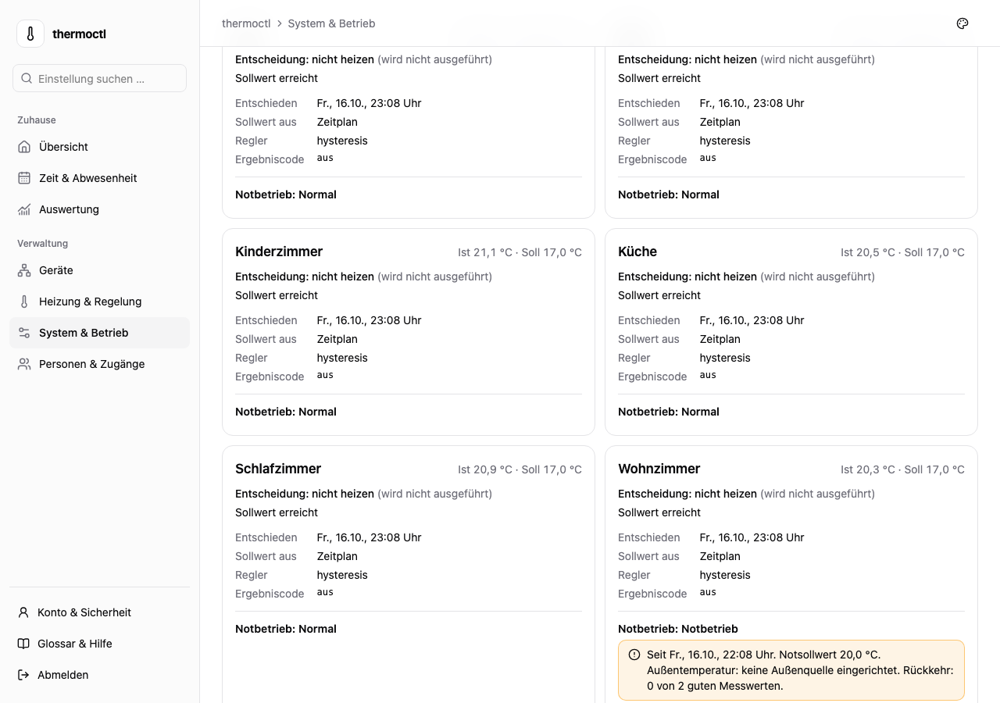

Läuft ein Raum im **Notbetrieb** (siehe [Notbetrieb bei Sensorausfall](#notbetrieb-bei-sensorausfall)
unten) oder gibt es einen Vergleich von Ersatzquelle und Wandfühler, steht unter seiner
Zeile ein eigener Kasten „Notbetrieb“: die Stufe, die aktive Quelle, bei der Rückkehrprüfung
der Fortschritt, die Sendefreigabe und je Aktor Takt-Phase und Übergabe. Darunter der
**Vergleich Ersatzquelle ↔ Wandfühler** der letzten Tage: je Thermostat die Zahl der
Messwerte, die mittlere Abweichung und ein **vorgeschlagener Ausgleichswert** — eine
Grundlage für die Kalibrierung, kein Wert, der sich von selbst übernimmt.

### Verbund, Verbindungen und Meldungen

**Verbund** zeigt die Führungsrolle dieser Instanz, **Verbindungen** die Schnittstellen
(MQTT, Zigbee2MQTT, Meross, Home Assistant, Homebridge, MCP, Webhook).

**Meldungen** schaltet sechs Arten von Störungsmeldungen einzeln ein oder aus
(Sensorstörung, Brücke/Broker weg, gescheiterter Schaltbefehl, festhängender Messwert,
Fenster vergessen offen, Problemmeldung aus einer Wohnung). Ein Testknopf prüft einen
hinterlegten Webhook, ohne auf eine echte Störung zu warten.

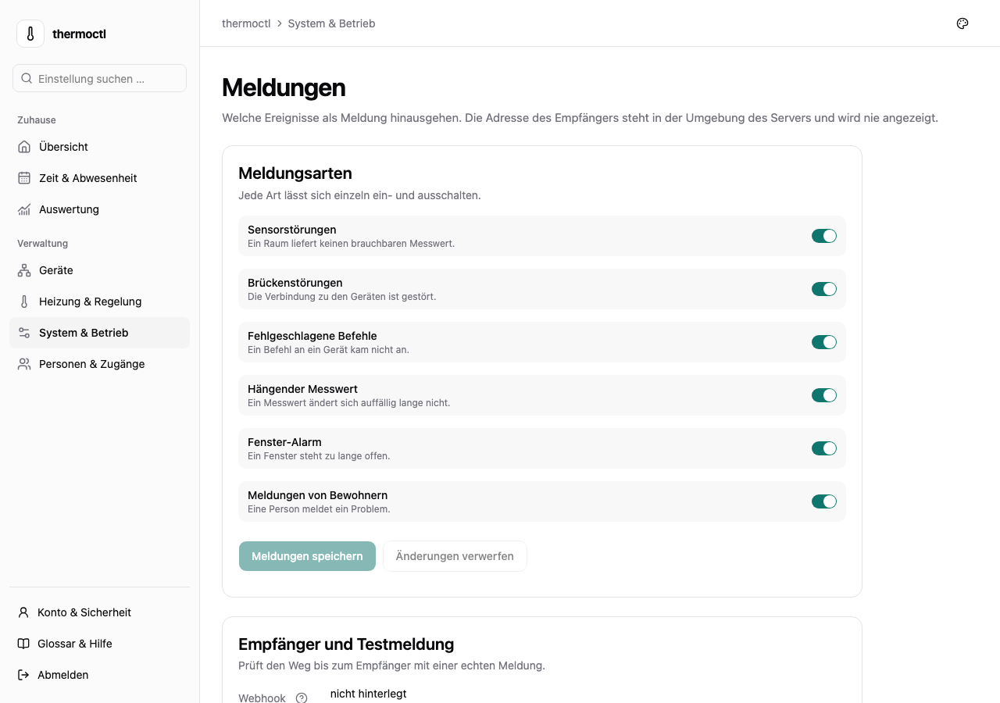

## Notbetrieb bei Sensorausfall

Fällt der Temperatursensor einer Zone aus, regelt `thermoctl` nicht mehr auf eine Messung,
die es nicht mehr gibt. Der Notbetrieb ist für **alle Zonen von Anfang an aktiv** — bei
bestehenden Anlagen seit dem Upgrade auf 0.11, bei neu angelegten Zonen von der Anlage
an. Er geht in Stufen vor:

1. **Ersatzquelle.** Zuerst nimmt die Zone die kälteste Messung der ihr zugeordneten
   Thermostat-Thermometer (korrigiert um den Ausgleichswert) anstelle des Wandfühlers. Die
   Entscheidung fällt dann nach der gewöhnlichen Hysterese; ein eingeschalteter PI-Regler
   ist in dieser Zeit ausgesetzt. Ein Thermostat, dem `thermoctl` gerade selbst eine
   Temperatur schreibt, misst dann möglicherweise nur das Echo davon; seine Messung gilt
   erst als unabhängig, wenn sie mindestens 30 Minuten nach dem letzten Sendeversuch
   entstanden ist (auch ein gescheiterter Versuch zählt).
2. **Notbetrieb.** Gibt es keine brauchbare Quelle, **takten Fußbodenkreise** — im
   Festtakt (Vorgabe 10 Minuten an, 20 Minuten aus) oder, wenn ein Außenwert vorliegt,
   nach der Außentemperatur-Kennlinie. Der Takt wird nicht an den Betriebsmodus „Aus"
   oder an ein offenes Fenster geknüpft. **Thermostate** bekommen je Störung
   und Zuordnung **höchstens einen** Übergabeversuch: Betriebsmodus „manual" und den
   Notsollwert (Vorgabe 20 °C); danach werden sie nicht mehr angesprochen. Für ein
   Gerät, zu dem es keinen bestätigten Gerätevertrag für diesen Befehl gibt, findet kein
   Übergabeversuch statt. Im Trockenlauf wird nichts gesendet.
3. **Rückkehrprüfung.** Geprüft wird jeweils eine Quelle. Sie wird beim Beginn der
   Prüfung gewählt — der Wandfühler, wenn er dann wieder liefert, sonst die Ersatzquelle —
   und bleibt an diese Prüfung gebunden; fällt sie erneut aus, geht die Zone zurück in den
   Notbetrieb derselben Störung. Die Quelle muss die eingestellte Zahl neuer Messwerte
   liefern (Vorgabe 2) und die eingestellte Dauer durchgehend brauchbar bleiben
   (Vorgabe 60 Sekunden). Beides läuft gleichzeitig ab dem Beginn der Prüfung; sie besteht,
   sobald beide Bedingungen erfüllt sind. Beides ist unter „Notbetrieb & Sensorfehler“ einstellbar. Besteht die
   Prüfung mit dem Wandfühler, geht die Zone zurück in den Normalbetrieb. Besteht sie
   mit der Ersatzquelle, kehrt die Zone in die Stufe Ersatzquelle zurück, und die Rückkehr
   zum Wandfühler wird danach eigens geprüft. Beim Abschluss der Störung (Rückkehr in den Normalbetrieb) soll ein
   Thermostat den Betriebsmodus zurückbekommen, den es vor der Übergabe gemeldet hat; war
   dieser Wert nicht bekannt, bleibt es still. Die Mindest-Ein- und -Aus-Dauern der
   Fußbodenkreise gelten dabei weiter.

Die Anlage kann je Störung eine Meldung zum Beginn und eine zur Entwarnung senden (mit dem
Schalter „Sensorstörung" unter Meldungen abschaltbar). Eine Zusage, dass jede genau
einmal ankommt, gibt es nicht: Nach einem Abbruch oder einem gescheiterten Versand wird
erneut gesendet. Bricht der Prozess auch während dieser Wiederholung ab, bevor der
Endzustand gespeichert ist, kann der nächste Lauf nochmals senden; eine Meldung kann deshalb
mehrfach ankommen. Scheitert die Wiederholung selbst, bleibt die Meldung aus. Auf der
Übersicht steht ein kurzer Hinweis in Klartext; Details für die Technik zeigt die Betriebsseite
(oben) und das Schaltprotokoll.

**Einstellen** lässt sich der Notbetrieb an zwei Stellen:

- **Heizung & Regelung → Notbetrieb & Sensorfehler** (anlagenweit): Festtakt
  (Sekunden an/aus), Rückkehrprüfung (Dauer und Zahl der Messwerte), Wiederanlaufspanne,
  anlagenweiter Notsollwert und die **Außenkennlinie**. Die Kennlinie besteht aus Zeilen
  (Außentemperatur, Sekunden an, Sekunden aus), die sich hinzufügen und entfernen lassen;
  sie braucht mindestens zwei Zeilen und genau einen oberen Punkt, ab dem nicht mehr eingeschaltet
  bleibt, und der Tastgrad darf mit steigender Außentemperatur nicht zunehmen. Eine leere
  Kennlinie heißt Festtakt. Ein Fehler in einer Zeile verwirft die ganze Eingabe.

  Die **Wiederanlaufspanne** (Vorgabe 1 K) wirkt nur zusammen mit einer Kennlinie und einem
  brauchbaren Außenwert: Hat die Außentemperatur den oberen Punkt erreicht, bleibt die Ein-Phase
  auf 0 gesperrt, bis die Außentemperatur unter diesen Punkt abzüglich der Spanne gefallen ist.
  So wechselt ein Wert, der um den oberen Punkt schwankt, nicht in jedem Takt zwischen Ein
  und Aus. Der Wert wird zu Beginn jedes Takt-Paares ausgewertet.

  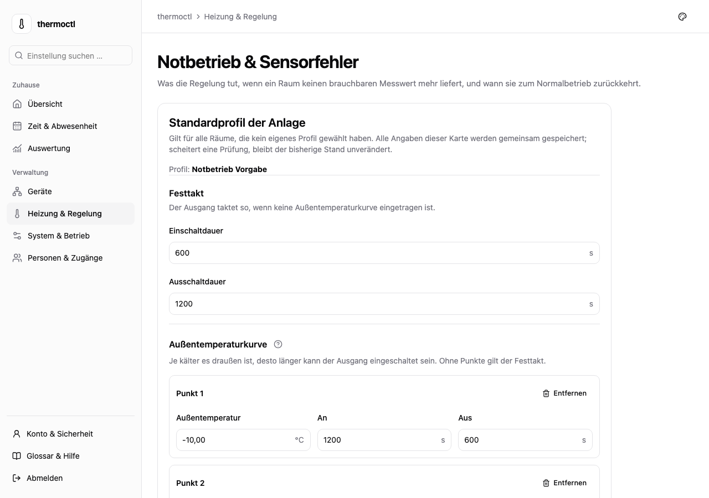

- **Raum → Raumtechnik → Gruppe „Notbetrieb“** (je Raum): den
  Notbetrieb für diesen Raum **ausschalten**, ein anderes vorhandenes Profil wählen oder
  einen eigenen Notsollwert setzen (leer = Anlagenwert erben), und je zugeordnetem
  Thermostat den **Ausgleichswert** (Gruppe „Ausgleichswerte der Ersatzquelle“; Recht `device.manage` nötig). Daneben stehen die
  wirksamen Werte und woher sie stammen. Die Gruppe gehört zum selben Formular wie die
  übrigen Regelparameter des Raums. Mehrere Profile
  anzulegen ist nicht vorgesehen; es gibt das eine anlagenweite Profil.

**Wichtig zu wissen:** Im Notbetrieb takten Fußbodenkreise nach der Uhr, **unabhängig von der
Raumtemperatur**. Das ist eine Notlösung für den Ausfall, keine Regelung; wer eine Zone
dauerhaft so betreibt, sollte den Sensor reparieren.

## Personen & Zugänge

**Personen & Rechte** hat zwei Reiter. Unter **Benutzer** werden Konten angelegt, einer
Gruppe zugeordnet, **gesperrt** (laufende Sitzungen enden, das Konto bleibt erhalten und lässt
sich wieder aktivieren) und mit **Passwort setzen** versehen — das beendet alle Sitzungen des
Kontos. Ein Konto ohne Gruppe hat keinerlei Rechte.

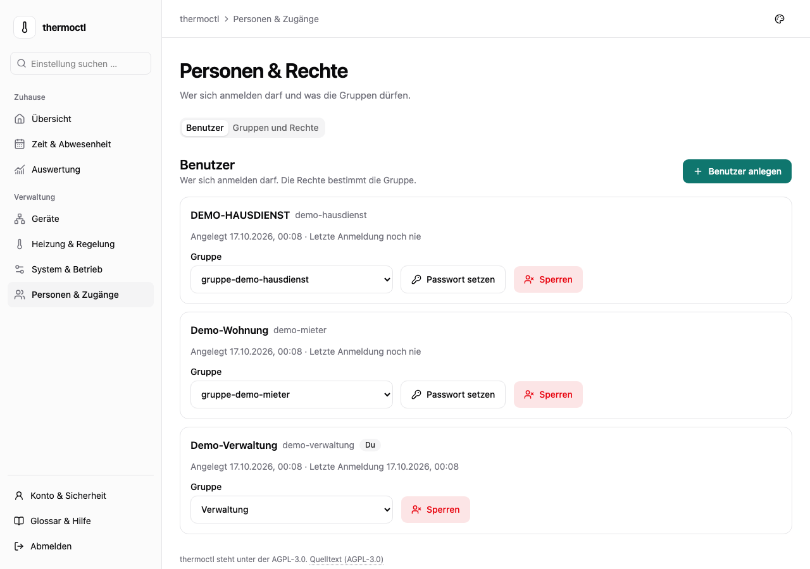

Unter **Gruppen und Rechte** hängen **Rechte an Gruppen, nicht an Personen.** Wer mehreren
Gruppen angehört, darf alles, was mindestens eine davon erlaubt. Vier eingebaute Gruppen
decken die üblichen Fälle ab (Bedienung, Integration, Nur lesen, Verwaltung); eigene Gruppen
lassen sich anlegen. Zonenbezogene Rechte lassen sich auf einzelne Räume beschränken, statt
anlagenweit zu gelten. Jede Gruppe trägt außerdem das **Oberflächen-Profil** (Anlage oder
Wohnung, siehe oben); beim Upgrade behält jede bestehende Gruppe das Anlagenprofil, für eine
Mietergruppe wird das Profil ausdrücklich auf Wohnung gestellt.

**API-Tokens** stellt man für den Zugriff über REST-API und MCP aus; **Kiosk-Zugänge** sind
der Zugang für ein Wandtablet (siehe Kiosk).

## Konto & Sicherheit

**Konto & Sicherheit** (Seitenleiste unten) ist der persönliche Bereich und für jeden
Angemeldeten erreichbar, unabhängig von jedem Recht: Benutzername, Oberfläche (Profil), Konto
seit, letzte Anmeldung; **Passwort ändern** (beendet alle anderen Sitzungen); jede
**andere Sitzung beenden**; **Passkeys verwalten**, sofern für die Anlage eine
Passkey-Anmeldung eingerichtet ist (ohne diese Einrichtung erscheint der Abschnitt nicht);
sowie **Abmelden**. Ein Link führt zu **Glossar & Hilfe**.

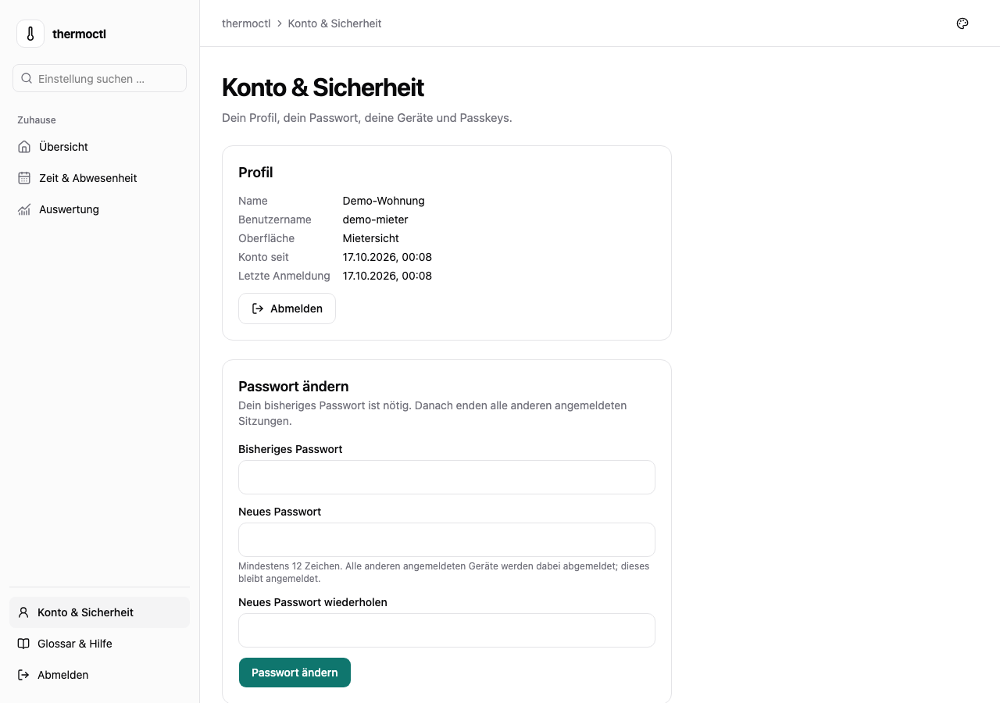

## Kiosk

Für das Wandtablet gibt es unter **Personen & Zugänge → Kiosk-Zugänge** einen eigenen Zugang
ohne Benutzerkonto: Ein Zugang bekommt einen Namen, eine Auswahl an Räumen, die er sehen
darf, optional die Erlaubnis zu bedienen (sonst „nur ansehen“) und optional eine Gültigkeit
in Tagen. Die Adresse `/kiosk/<token>` erscheint danach genau einmal im Klartext — sie
gehört als Lesezeichen aufs Tablet, danach lebt das Token nur noch im Cookie. Ein Zugang
lässt sich jederzeit widerrufen; das Tablet zeigt dann nichts mehr an.

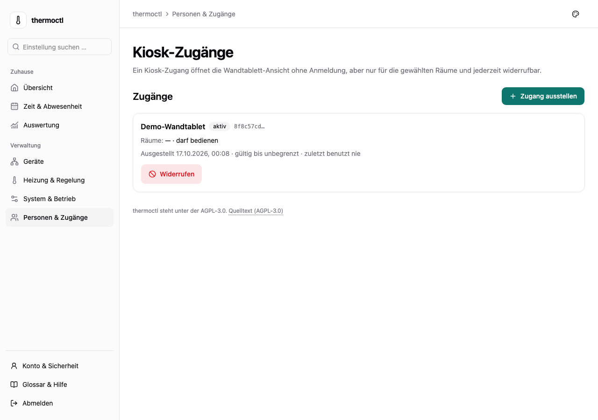

Die Kioskansicht ist eine eigene Seite **mit JavaScript** (die frühere Kioskseite lief ohne).
Oben wählt man die Ansicht — **Automatisch** (nach Bildschirmbreite), **Panel** (kompakte
Kacheln, Antippen öffnet den Raum) oder **Tafel** (alle Räume als Karten) — und die
Darstellung (System, Hell, Dunkel). Die Schaltflächen − und + am Sollwert erscheinen nur,
wo die Aktion erlaubt ist.

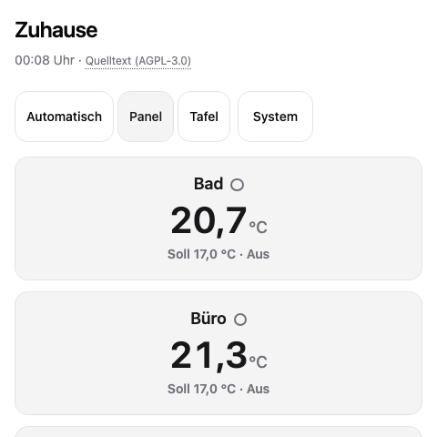

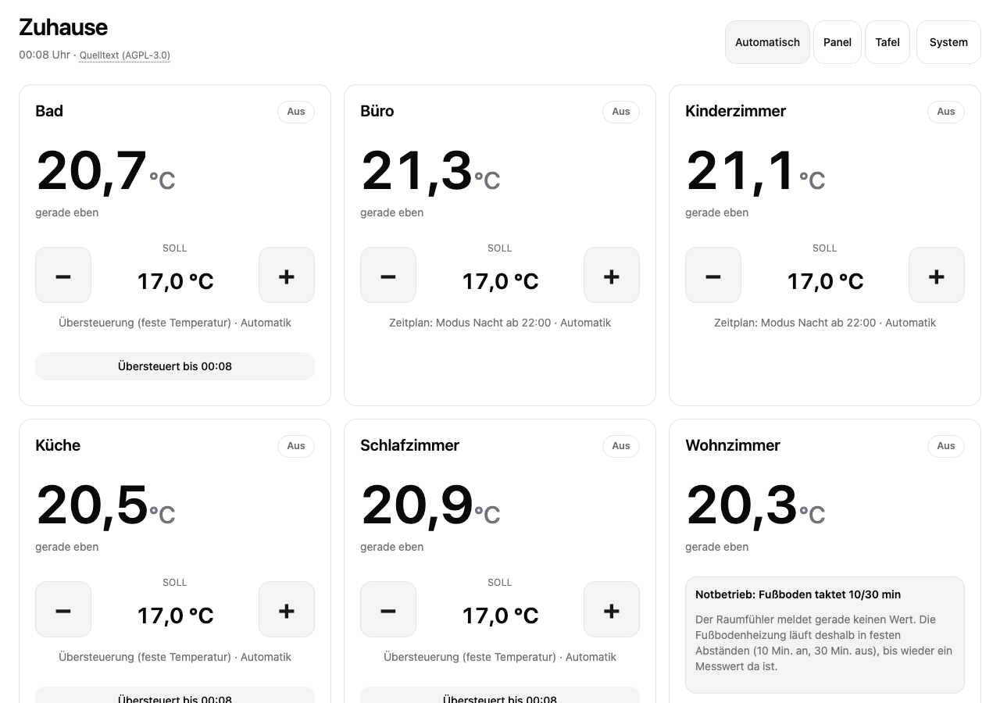
