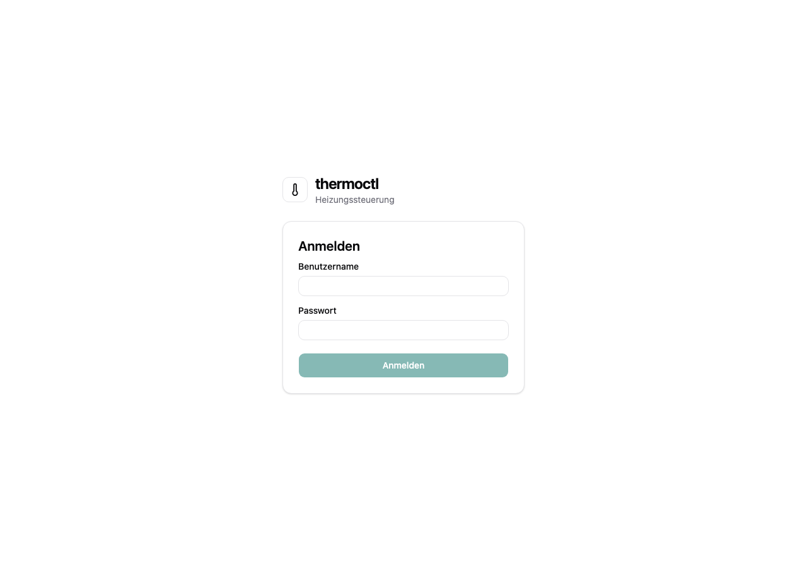
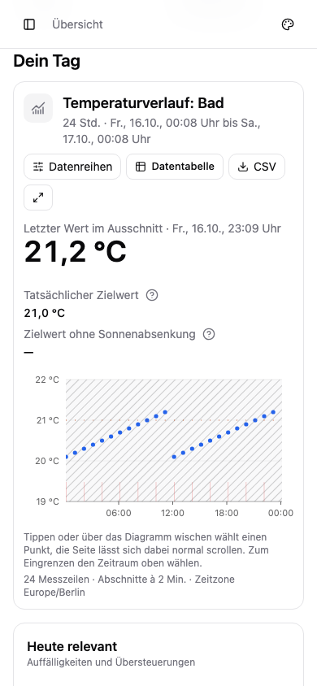
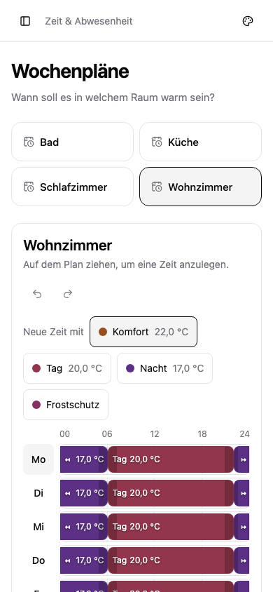
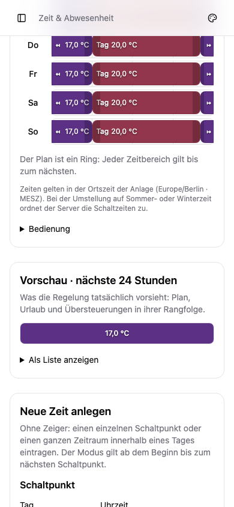
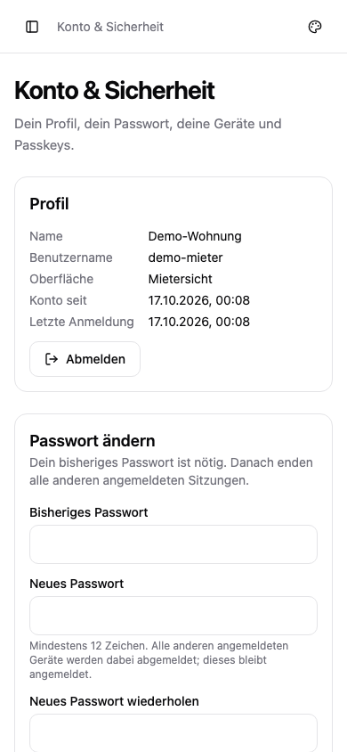
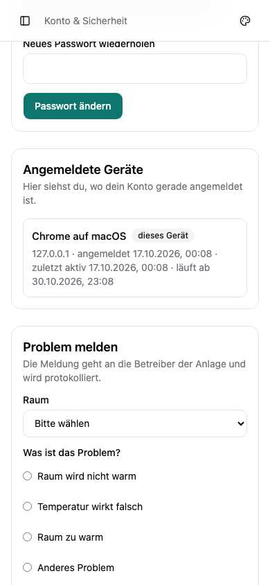

# Ihre Wohnung online steuern

Diese Anleitung erklärt, wie Sie Ihre Heizung über den Webbrowser sehen und bedienen —
vom Handy, Tablet oder Computer aus. Sie brauchen dafür nichts zu installieren: Die
Zugangsdaten (Adresse, Benutzername, Passwort) haben Sie von der Verwaltung Ihrer Anlage
erhalten. Die Verwaltung bedient dieselbe Anwendung; was Ihnen angezeigt wird, hängt von
Ihrer Gruppe ab. Die Technik der Anlage (Geräte, Betrieb, Einstellungen, Benutzer,
Berichte, Urlaub) gehört zur Verwaltung und erscheint bei einem Wohnungskonto nicht.

## Anmelden und Aufbau

Rufen Sie die Ihnen genannte Adresse im Browser auf und melden Sie sich mit Benutzername und
Passwort an.

Am Telefon blenden Sie die Seitenleiste über die Schaltfläche oben links ein. Sie führt zu
**Übersicht**, **Zeit & Abwesenheit** (die Wochenpläne) und **Auswertung** (Temperatur &
Heizzeit) sowie ganz unten zu **Konto & Sicherheit**, **Glossar & Hilfe** und **Abmelden**.
Das Farbsymbol oben rechts wechselt zwischen hellem und dunklem Aussehen. Sie sehen
ausschließlich die Räume, für die Sie freigeschaltet wurden.

## Übersicht: Ihre Räume auf einen Blick

Die Übersicht ist Ihr persönliches Dashboard aus Kacheln. Sie zeigt Kennzahlen wie die
Zahl Ihrer Räume und der Räume, die gerade Wärme anfordern, und für jeden Raum eine Karte
mit gemessener Temperatur, Sollwert und einer kurzen Begründung, warum gerade dieser Wert
gilt. Mit **Anpassen** stellen Sie die Kacheln nach Ihren Wünschen zusammen.

Weiter unten steht zum Beispiel der Temperaturverlauf eines Raums:

Ein Tipp auf eine Raumkarte öffnet den Raum. Je nach Ihren Rechten ändern Sie dort die
Temperatur:

- **Sollwert − / +** ändert die normale Temperatur des gerade laufenden Zeitabschnitts
  **dauerhaft**, nicht nur für heute. Läuft gerade eine Übersteuerung, ist der Knopf
  gesperrt: erst beenden, dann den Sollwert ändern.
- **Befristete Übersteuerung** stellt eine feste Temperatur bis zu einem gewählten Zeitpunkt
  ein. Danach gilt wieder der Wochenplan; Sie können sie auch vorzeitig beenden.
- **Nächste Phase** zeigt, was der Wochenplan als Nächstes vorsieht. **Jetzt vorziehen**
  nimmt es vorweg. Läuft schon eine Übersteuerung, steht dort **Übersteuerung ersetzen**.

**Wenn ein Raum einen Hinweis zum Notbetrieb zeigt:** Der Temperaturfühler des Raums meldet
gerade keinen Wert. Die Anlage schaltet die Fußbodenheizung dann nach festen Zeiten ein und
aus, bis wieder eine Messung da ist, und Heizkörper-Thermostate bekommen einmal einen festen
Sollwert. Die Temperatur, die Sie einstellen, kann in dieser Zeit nicht genau eingehalten
werden. Sie müssen nichts tun. Bleibt der Hinweis lange stehen, melden Sie das unter
**Problem melden** (siehe unten).

## Zeit & Abwesenheit: Wochenplan und Verreisen

Die Seite **Wochenpläne** zeigt je Raum, wann es wie warm sein soll. Wählen Sie oben den Raum.
Im Wochenraster ziehen Sie mit dem Finger oder der Maus eine neue Zeit auf; vorher wählen Sie
unter „Neue Zeit mit“ den Modus (Komfort, Tag, Nacht, Frostschutz). Vorhandene Blöcke
verschieben oder kürzen Sie, ein Antippen öffnet die genauen Zeiten und die Temperatur.
Änderungen lassen sich mit **Rückgängig** zurücknehmen.

Weiter unten stehen die Vorschau der nächsten 24 Stunden und das Formular **Neue Zeit
anlegen**. Damit tragen Sie einen Schaltpunkt (Tag, Uhrzeit, Modus) oder einen Zeitraum
innerhalb eines Tages (Tag, Von, Bis, Modus) auch ohne Ziehen ein:

Den Wochenplan sehen und ändern Sie nur, wenn Ihre Gruppe das Recht dazu hat. Eine
befristete Übersteuerung verändert den Plan **nicht**; sobald sie endet, gilt er unverändert
weiter.

**Abwesenheit:** Auf derselben Seite tragen Sie ein, bis wann Sie zurück sind und auf welche
Temperatur **alle Ihre Räume** währenddessen gehalten werden sollen. Der Wochenplan bleibt
gespeichert und gilt danach von selbst wieder. Eine laufende Abwesenheit lässt sich jederzeit
vorzeitig beenden. Der Urlaub für die ganze Anlage ist Sache der Verwaltung.

## Auswertung: Temperatur & Heizzeit

**Temperatur & Heizzeit** zeigt je Raum oder für alle Räume ein Diagramm über 24 Stunden,
7 oder 30 Tage; der gewählte Zeitraum gilt für alle Räume. Steuert die Anlage noch nichts,
steht oben der Hinweis „Die Anlage steuert derzeit nichts“: Dann zeigt der Verlauf, was die
Regelung entschieden hätte. Zielwert und Heizanforderung sind Entscheidungen, keine
Aufzeichnung dessen, was in den Räumen geschah.

- Die **Linie** ist die gemessene Temperatur. Bei langen Zeiträumen steht jeder Punkt für
  einen kurzen Abschnitt; der helle Bereich zeigt niedrigsten bis höchsten Messwert darin.
- Die **Stufenlinien** zeigen den Zielwert ohne Sonnenabsenkung (so, wie ihn Zeitplan,
  Abwesenheit, Urlaub, Betriebsart Aus oder eine Änderung von Hand vorgeben) und den
  **tatsächlichen Zielwert**, nach dem die Regelung gearbeitet hat.
- Das **Band der Sonnenabsenkung** zeigt, wann die Regelung den Zielwert wegen erwarteter
  Sonne abgesenkt hat; der Frostschutz soll dabei nicht unterschritten werden.
- Die **schmale Spur** zeigt den Anteil der Zeit mit **Heizanforderung**. Sie sagt nichts
  darüber, wie es im Raum war.
- Mit der **Maus** (am Telefon: antippen) lesen Sie die Werte an einer Stelle ab. Wo
  „keine Daten“ steht, gibt es keine Aufzeichnung; nichts wird dazugerechnet. **Vollbild**
  vergrößert nur dieses Diagramm, die **Datentabelle** ist die Textfassung.

Darunter zeigt **Heizzeit** je Raum, wie viele Stunden im gewählten Zeitraum eine
Heizanforderung bestand. Das ist eine grobe Orientierung, **kein** Energie- oder
Kostenmesser: Wie warm ein Raum wurde, hängt auch vom Wetter, vom Gebäude und vom Lüften ab.
Im Trockenlauf zeigen die Balken, wann geheizt worden *wäre*.

## Konto & Sicherheit

Unter **Konto & Sicherheit** finden Sie Ihr Profil (Name, Benutzername, letzte Anmeldung) und:

- **Passwort ändern** — dafür brauchen Sie das bisherige Passwort. Danach bleibt nur das
  gerade genutzte Gerät angemeldet, alle anderen brauchen eine neue Anmeldung.
- **Angemeldete Geräte** und **Andere Sitzungen beenden** — meldet Ihr Konto auf allen anderen
  Geräten ab, falls z. B. ein Handy verloren ging.
- **Passkeys**, wenn die Anlage sie eingerichtet hat: Ihr Gerät (Fingerabdruck,
  Gesichtserkennung oder Sicherheitsschlüssel) als bequemerer Anmeldeweg.
- **Abmelden.**

Hilfe und Abmelden stehen weiter unten:

Unter **Glossar & Hilfe** erklärt die Oberfläche die Fachbegriffe in einfachen Worten; an
vielen Stellen führt ein kleines Fragezeichen direkt zum passenden Eintrag.

## Wenn etwas nicht stimmt

Haben Sie das Recht dazu, finden Sie unter **Problem melden** ein kurzes Formular: Sie wählen
aus, worum es geht (z. B. Raum wird nicht warm, Temperatur wirkt falsch, Raum zu warm), und
können einen Hinweis dazuschreiben. Raum, letzter Messwert und aktueller Sollwert werden
automatisch mitgeschickt. Die Meldung geht an die Verwaltung Ihrer Anlage.

Wenden Sie sich außerdem direkt an die Verwaltung, wenn:

- ein Raum fehlt, der eigentlich zu Ihrer Wohnung gehört,
- Sie ein neues Passwort brauchen, weil Sie Ihres vergessen haben (selbst ändern können Sie es
  nur, solange Sie angemeldet sind),
- oder Sie etwas ändern möchten, wozu Ihr Konto keine Rechte hat, etwa Temperaturen je Modus
  oder die Betriebsart eines Raums.

**Was Sie hier nicht sehen und nicht ändern können, ist Absicht:** Räume anderer Wohnungen,
die Technik der Heizungsanlage (Geräte, Sensoren, Funk), Benutzer und Gruppen sowie der
Betriebszustand der Anlage insgesamt. Dafür ist die Verwaltung zuständig. Welche Seiten ein
Konto sieht, trennt das Profil der Gruppe; was es tatsächlich darf, entscheiden allein die
Rechte. Das beschreibt [die Bedienungsanleitung der Verwaltung](bedienung.md).
